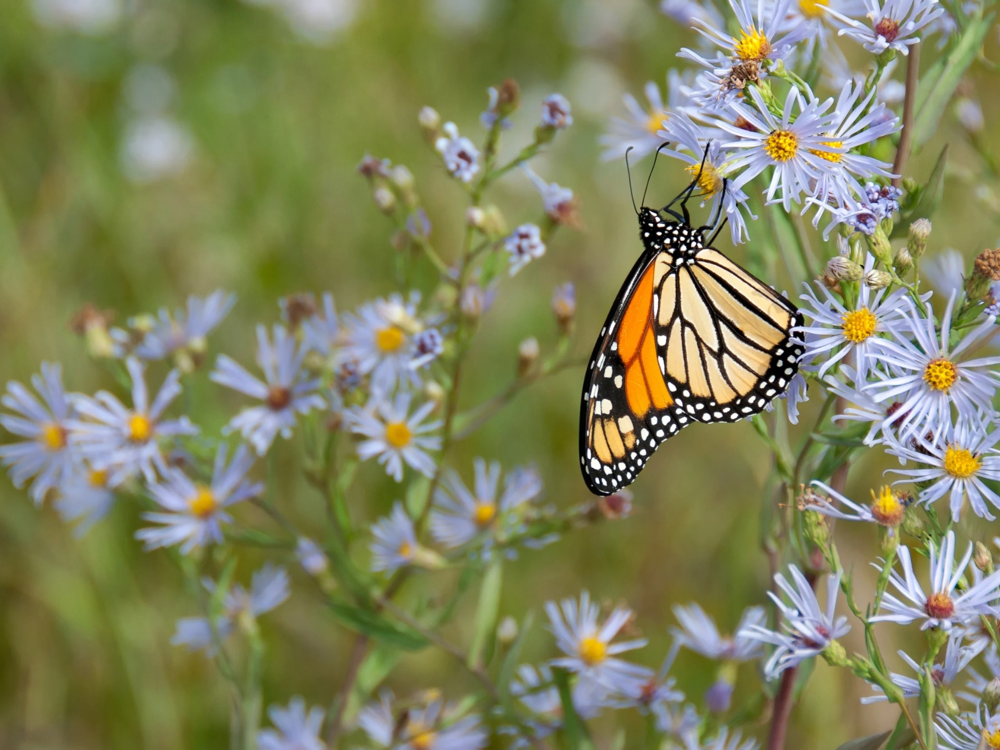
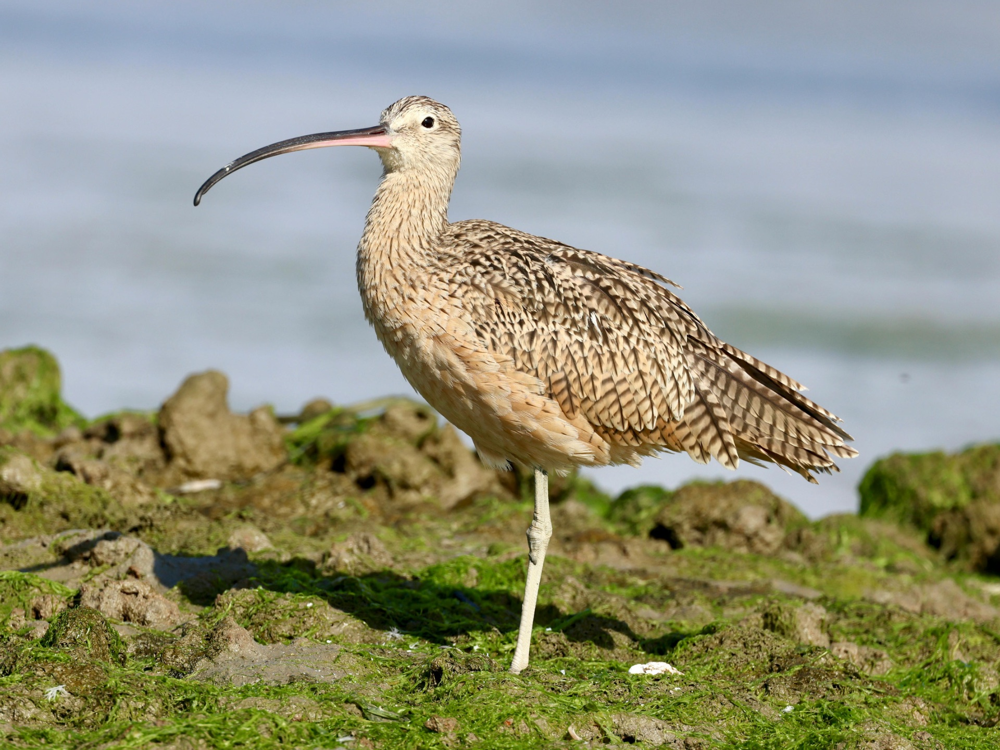
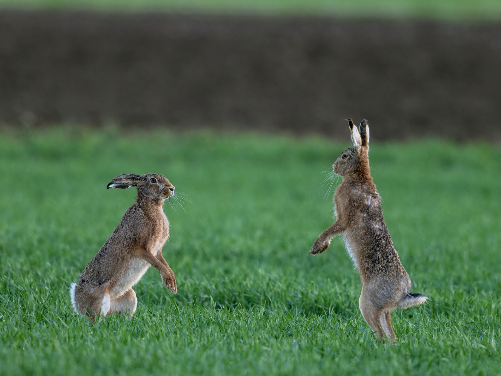
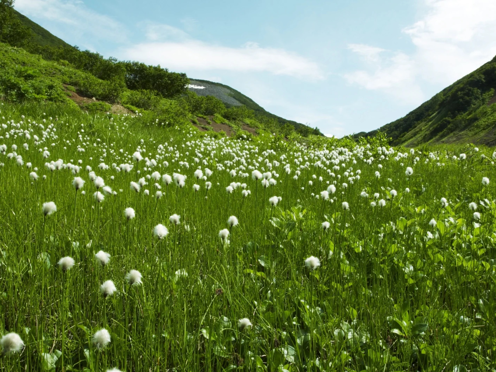

There’s a hum in the air that seems to reverberate through your whole body. Gentle breezes wave the grasses, adding to the dance of the bees, butterflies, beetles and other insects that hurry busily from one flower to another. Dappled with red, pink, white, yellow, purple and blue, this meadow hums with life. Overhead a kestrel cries as she quarters for the voles that you can hear squeaking, hidden beneath the thick grass. A British meadow, rich in wildlife, a symbiosis formed between human endeavour and nature as a whole.

Grasslands and meadows define this country just as much as our woodlands. They are diverse, ranging from mountain pastures to chalk downs and floodplain meadows. They cover [more than 40%](https://www.plantlife.org.uk/our-work/the-grassland-gap/) of our land, and have been bound up in our history and culture for millennia. A wildflower grassland in summer is a thing of pure joy, bursting with life and sound, and in autumn and winter, if they are left to go over, they provide habitat for many rodents, helping our mesopredators like foxes and owls survive the winter. It’s a habitat that’s around [12,000 years old](https://www.wildlifetrusts.org/habitats/grassland), growing into the earth left by the retreating glaciers after the last ice age.

It’s a well-repeated fact that we lost 97% of our meadows, truly some of our most diverse grasslands, between the 1930s and 1980s. [Less than 1%](https://www.plantlife.org.uk/wp-content/uploads/2023/08/Grasslands-as-a-Carbon-Store.pdf) of our country is now considered to be species-rich grassland. Devastating, given that rich grasslands can have as many as 30 species of wildflower within a quarter of a square metre. This catastrophic decline has dire consequences for our rare habitats and species that rely on them, as well as resilience to climate change, biodiversity collapse, and our dependence on them to sustain pollinators for our crops. Much of this is due to a [shift away](https://www.plantlife.org.uk/wp-content/uploads/2023/07/Plantlife-report-1-Status-Trends-and-Definitions-of-UK-Grasslands.pdf) from traditional agricultural practices, to more intensive, industrialised farming, as well as neglect of those grasslands whose value is based on biodiversity and not productivity.

Our grasslands are wondrously diverse, covering uplands and lowlands, chalk, limestone, clay and loam, dry and wet land. All of these differences in geography and geology create varied habitats and assemblages of species, with their own unique specialisms and expressions. Grasslands are usually [classed](https://www.wildlifetrusts.org/habitats/grassland) as:

- Calcareous - found on shallow lime-rich soils
- Acidic - found on sands, gravels and siliceous rocks
- Neutral - found on clay and loam soils

These can be upland or lowland, wet or dry.

Grasslands depend on grazing, and many of the grasslands we still have today exist because we have grazed animals in lieu of herds of wild herbivores. Meadows are a joint effort between grasslands and human agriculture, with the oldest in the UK first noted down in the 9th century - [Waun Henllan](https://www.llanellinaturalists.org.uk/index.php/newsletters/sites/279-waun-henllan-britain-s-oldest-meadow) in Wales. Grown for hay, the late cutting allows for seeds to sow back into the soil, and for ground-nesting birds to rear chicks in safety before taking to the skies again. Unfortunately now, fast growing grasses are cut early, and often multiple times a season, and made into silage, meaning crashing biodiversity and tragedies of eggs and chicks of ground-nesting birds unable to escape tractors.

Our grasslands are incredibly biodiverse, with species of plant, fungi and animals making their homes in the sunlit grasses. The rodents that like to make their tunnels through long grass feed the birds of prey, foxes and badgers. Rare orchids, adders and waxcaps can all be found here. Abundant wildflowers grow, including Bird’s Foot Trefoil, which is a food plant for 130 species, and key for the caterpillar of the Common Blue Butterfly. Hares box and rabbits jink, the curlew and the lapwing build their nests and raise their young. Dung beetles bury nutrients down deep into the soil, sharing the earth with ants, moles and mycelium. They are valuable corridors, connecting up different areas and habitats, providing food, shelter, and even places to display, mate and rear young. The bountiful insect life sees swallows swooping to catch them, a beautiful sight.

Grasslands are also an incredible carbon store. They account for around a [third](https://www.nffn.org.uk/resources/grazing-management-to-preserve-pastures-grasslands) of the planet’s carbon storage, and around [two billion tonnes](https://www.plantlife.org.uk/wp-content/uploads/2023/08/Grasslands-as-a-Carbon-Store.pdf) in the UK, to a depth of 100cm. They are, however, sensitive to disturbance, and between 1990 and 2006, the conversion into arable farming released [14 million tonnes](https://www.wildlifetrusts.org/habitats/grassland) of CO2 into the atmosphere. What benefits diversity also [benefits carbon storage](https://www.plantlife.org.uk/wp-content/uploads/2023/08/Grasslands-as-a-Carbon-Store.pdf), since plant roots, fungi and bacteria all hold carbon in the soil. By moving to less intensive farming and land management practices, we can improve biodiversity and store more carbon - and the carbon stored is less vulnerable to wildfires, since the majority of it is stored below ground.

Supporting wilder grasslands also has other benefits. They reduce air and water pollution, make the soil more productive, and support our historical and cultural connection to grasslands - something we’ve developed ever since humans returned after the ice age, 10,000 years ago.

By rooting deep into the soil, grasslands prevent soil erosion, stopping soil and nutrients from entering our waterways and causing eutrophication, where there are too many nutrients in the water, and algae grows, suffocating the life in the rivers and lakes. It also can absorb [water](https://www.plantlife.org.uk/wp-content/uploads/2023/08/Grasslands-as-a-Carbon-Store.pdf) more easily, meaning it can stop water running off and causing floods during heavy rainfall, and also having deep reserves for times of drought. Grasslands are a key part of [climate resilience](https://www.plantlife.org.uk/wp-content/uploads/2024/09/Grassland-Action-Plan-England-Briefing-Plantlife.pdf) for now, and the future.

This works with sustainable food production - more resilient landscapes and grasslands means that we will continue to be able to grow crops, and animals grazed on healthy grasslands will in turn be healthier themselves. This is a way that we can continue our long and beautiful culture of working with grasslands to feed ourselves - something that [won’t be possible](https://www.bbc.co.uk/food/articles/soil) if we continue as we are.

The truth is that, as with all our ecosystems and habitats, we are failing our grasslands. Despite there being 4.5 million hectares of grassland in England alone, only [100,000 hectares](https://www.wildlifetrusts.org/habitats/grassland) are species-rich, ‘unimproved’ grasslands. On top of the well-known 97% loss of meadows in England, Scotland also [lost 40%](https://www.nffn.org.uk/resources/grazing-management-to-preserve-pastures-grasslands) of its biodiverse grasslands between 1983 and 2005.

The intensive, destructive, and short-sighted land management practices that have dominated the past few decades, such as intense fertilisation, ploughing and herbicides all do their damage. Ploughing releases carbon into the atmosphere, as does the conversion into arable, leading to up to [59% decline](https://www.plantlife.org.uk/wp-content/uploads/2023/08/Grasslands-as-a-Carbon-Store.pdf) in soil carbon stores. We’ve lost most of our lowland grasslands over the course of the 20th century, due to government incentives around and after World War 2. The uplands have been [over-grazed](https://www.wildlifetrusts.org/habitats/grassland), causing destruction of rare grassland ecosystems like blanket bog.

These trends haven’t stopped - we’re still losing our grasslands at an alarming rate, and with it, our fellow species, like snake’s-head fritillary and curlew, along with the catastrophic collapse of insect populations - something that spells disaster for all life, including us.

But the good news in all this is that we can restore our grasslands! And not only that, but humans are needed for this. Most types of healthy grassland need some kind of grazing - or indeed cutting (or scything!). Over at the [Nature Friendly Farming Network](https://www.nffn.org.uk/), they provide [guidance](https://www.nffn.org.uk/resources/grazing-management-to-preserve-pastures-grasslands) to nature-loving farmers on how to graze their animals to enhance grasslands, and with healthier and more biodiverse grasslands, comes healthier and more resilient animals. There is an alternative to the industrialisation of agriculture, and there are many in the farming sector who have been working for a long time to make changes, and create a sustainable and reliable future for farmers and consumers.

At [Plantlife](https://www.plantlife.org.uk/), they have been [working on](https://www.plantlife.org.uk/our-work/the-grassland-gap/) the UK Government to prioritise grasslands and commit to developing a Grassland Action Plan for England - something that we have for woodlands and peatland, but completely lacking for grasslands.

And here at Protect Earth, we are delving deep into the best way to help restore the grasslands we are managing. We have been lucky enough with the [Warleigh Nature Reserve](https://protect.earth/sites/warleigh-nature-reserve/), to be able to tend to some rare calcareous grassland. In this chalky earth there is little fertility, meaning that all of the quick-growing grasses that usually out-compete everything else can’t get a hold, and instead leaves the way open for stunning and rare wildflowers. For now, we’re focusing on human proxies for grazing, and held our first scything session there this summer!

You can become a part of the Protect Earth grassland restoration project, by [sponsoring](https://shop.protect.earth/products/grassland-restoration-by-the-square-meter) a square meter of restoration! Truly, every square sponsored makes a difference, and all of the money donated goes on actually doing the work.

There’s hope still for our grasslands, from lowland meadows to upland blanket bog - there’s time to make them more resilient, and so make all of our landscapes more resilient.
